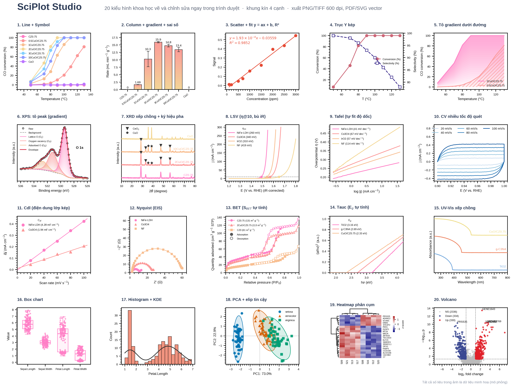
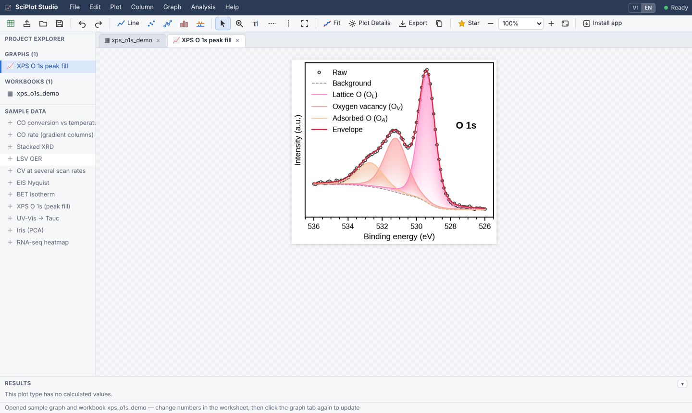

# SciPlot Studio

**Publication-quality scientific figures, drawn and edited right in your browser. Free, offline-capable, and your data never leaves your computer.**

[](https://lephong2810.github.io/SciPlotStudio/)
[](sciplot/LICENSE)
[](https://github.com/lephong2810/SciPlotStudio/stargazers)



SciPlot Studio is a worksheet + graph editor built for researchers in materials science, catalysis, electrochemistry and the life sciences. You paste or import your data, pick a plot type, then fine-tune every element by double-clicking it, and finally export a figure ready for a journal. No installation, no account, no license key.

👉 **Try it now: <https://lephong2810.github.io/SciPlotStudio/>**

---

## Features

- **20+ plot types:**
  - *General:* line, scatter, line + symbol, column (with error bars, gradient fill and value labels), area, double Y axis.
  - *Materials and electrochemistry:* stacked XRD with phase markers (▼ ★), XPS with peak filling, stacked Raman / FTIR / UV-Vis, LSV, Tafel, CV, C<sub>dl</sub>, Nyquist (EIS), BET isotherm, Tauc plot.
  - *Statistics and omics:* box, histogram + KDE, PCA with confidence ellipses, clustered heatmap, volcano plot.
- **Built-in calculations:**
  - Linear and polynomial fits (y = ax + b, R², adjusted R², standard errors).
  - η at 10 mA cm⁻² with iR compensation and conversion to RHE.
  - Tafel slopes, S<sub>BET</sub> and C constant, band gap E<sub>g</sub>, double-layer capacitance C<sub>dl</sub>.
  - Results can be sent back into a worksheet.
- **Interactive editing:**
  - Double-click an axis, label, legend, series or text to edit it.
  - Drag the legend, annotations and sample names; nudge them with the arrow keys.
  - Zoom by rubber-band selection; full undo/redo.
- **Journal-ready styling:**
  - Closed 4-side box frame with inward or outward ticks and minor ticks.
  - Sans/serif fonts and math text (`cm$^{-2}$`, `$\eta_{10}$`).
  - Curated colour palettes: pastel, NPG-style, Okabe–Ito and Paul Tol (both colour-blind safe), sequential and gradient presets.
  - Size templates for 1- and 2-column figures.
- **Export:**
  - PNG / TIFF at 300–1200 dpi, PDF / SVG vector (text stays editable).
  - Copy to clipboard for Word and PowerPoint.
  - Combine several graphs into one multi-panel figure labelled (a) (b) (c).
- **Data in, your way:**
  - Excel (multi-sheet, multi-row headers for name / unit / comment), CSV, TXT, or paste directly from a spreadsheet.
  - Columns are designated X / Y / Y Error / Label.
  - Long-format tables can be unstacked by group.
- **Private and offline:**
  - All computation runs locally in your browser (Python via Pyodide). Nothing is uploaded.
  - Install it as an app on macOS, Windows, Linux or iPad; after the first visit it works without internet.
- **English / Tiếng Việt interface:** switch any time with the **VI | EN** toggle.



## Quick start

1. Open <https://lephong2810.github.io/SciPlotStudio/>, wait for the green **Ready** dot (the first load downloads ~30–40 MB and is cached afterwards), then:
   - **Import data:** use **File → Import data** (Excel / CSV / TXT), drag and drop a file, or paste from Excel. Header rows become *Long Name* and *Units*.
   - **Or start from a sample:** pick one from **Sample data** on the left. The graph opens together with its workbook, so you can simply replace the numbers.
2. Click the header of one or more Y columns, then choose a plot type from the **Plot** menu or the toolbar.
3. **Double-click** anything on the graph to edit it. Press **F4** for Plot Details (series, colours, symbols, fill, fit).
4. Export with **File → Export** (Ctrl/⌘ E), or **File → Combine graphs** to build a multi-panel figure.

**Install as an app:**
- *Safari on macOS 14+:* File → Add to Dock.
- *Chrome / Edge:* use the install icon in the address bar.
- *iPad / iPhone:* Share → Add to Home Screen.
- *Any browser:* the **Install app** button in the toolbar also works.

| Shortcut | Action |
|---|---|
| Ctrl/⌘ Z · Y | Undo · redo |
| Ctrl/⌘ S · O | Save · open project (`.sciplot.json`) |
| Ctrl/⌘ E | Export figure |
| Ctrl/⌘ L | Linear / polynomial fit |
| Ctrl/⌘ R | Rescale axes |
| Ctrl/⌘ + / − / 0 | Zoom graph in / out / 100 % |
| F4 | Plot Details |

## Python library and command line

The same plotting engine is available as a Python module (`sciplot/sciplot.py`) for scripts, Jupyter notebooks and batch work:

```bash
pip install -r sciplot/requirements.txt
python sciplot/sciplot.py xrd sciplot/examples/xrd_demo.csv --x two_theta --y intensity --sample sample -o xrd.png
python sciplot/sciplot.py lsv sciplot/examples/lsv_oer_demo.csv --E E_V --j I_mA --sample sample \
       --ref Hg/HgO --pH 14 --R 2.5 --area 0.196 --current_unit mA --reaction OER -o lsv.pdf
```

```python
import sciplot as sp
sp.set_theme("boxed", font="sans", fontsize=10)
df = sp.load_table("lsv.xlsx")
fig, ax = sp.tafel(df, E="E_V", j="I_mA", sample="sample", ref="Hg/HgO", pH=14, fit_range=(1, 10))
print(sp.results(ax))                    # Tafel slopes (mV dec⁻¹), R²
sp.save(fig, "tafel.png", dpi=600)
```

Full parameter reference (in Vietnamese): [`sciplot/README.md`](sciplot/README.md).

## Repository layout

```
index.html             redirect to the web app
sciplot/
├── docs/              the web app (GitHub Pages): index.html, app.js, i18n.js, studio.py, sciplot.py, sw.js …
├── sciplot.py         plotting engine / Python library / CLI
├── app.py             optional Streamlit front-end
├── examples/          simulated demo datasets (CSV) and panel definitions (JSON)
├── gallery/           example output
├── build_docs.py      syncs the engine into docs/ and bumps the app version
├── CITATION.cff       citation metadata
├── LICENSE            MIT
└── THIRD_PARTY_NOTICES.md
```

After editing `sciplot.py` or anything in `docs/`, run `python sciplot/build_docs.py` before pushing. This bumps the version, so installed apps pick up the update.

## Support the project and cite it

SciPlot Studio is free for everyone. If you find it useful:

- ⭐ **Star this repository.** It helps other researchers find the tool.
- **Acknowledge SciPlot Studio** in your papers, theses and reports. Copy-ready sentences are also in the app under **Help → ⭐ Support & cite**.

> **Acknowledgments:** The authors thank Dr. Phong Hoai Le (University of Science, VNU-HCM, Vietnam) for developing SciPlot Studio (https://github.com/lephong2810/SciPlotStudio), which was used to prepare the figures in this work.

> **Methods / Experimental:** Figures were prepared using SciPlot Studio (version 1.0; P. H. Le, University of Science, VNU-HCM, Vietnam; https://github.com/lephong2810/SciPlotStudio).

> **Figure caption / SI:** Plotted with SciPlot Studio v1.0 (https://github.com/lephong2810/SciPlotStudio).

> **Reference (ACS style):** Le, P. H. *SciPlot Studio*, version 1.0; University of Science, VNU-HCM: Ho Chi Minh City, Vietnam, 2026. https://github.com/lephong2810/SciPlotStudio.

GitHub's **"Cite this repository"** button (from `CITATION.cff`) also gives APA and BibTeX formats.

## Feedback

Found a bug or have a feature request? Please open an [issue](https://github.com/lephong2810/SciPlotStudio/issues). Example files that reproduce the problem are very welcome; please share only data you are allowed to share.

## License and notices

- SciPlot Studio is released under the [MIT License](sciplot/LICENSE). © 2026 Phong Hoai Le.
- It is built on open-source software: Pyodide, CPython, matplotlib, NumPy, SciPy, pandas, adjustText, SheetJS Community Edition and the Liberation fonts. Their licenses are listed in [THIRD_PARTY_NOTICES.md](sciplot/THIRD_PARTY_NOTICES.md).
- SciPlot Studio is an independent project and is not affiliated with, sponsored by, or endorsed by any software vendor or publisher. All trademarks belong to their respective owners. Palette names such as "NPG-style" describe a colour style only.
- All data in the bundled examples and in the gallery image are simulated.

---

<sub>Developed by Phong Hoai Le · Faculty of Chemistry, University of Science, Vietnam National University Ho Chi Minh City.</sub>
